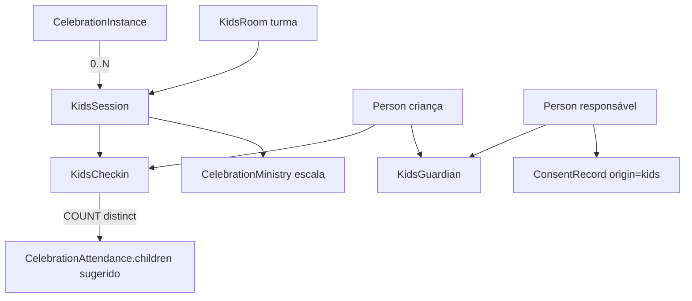

# Módulo Kids Design

**Spec**: `.specs/features/modulo-kids/spec.md`
**Status**: Draft

---

## Architecture Overview

Kids vive dentro do módulo de celebrações da API (`apps/api/src/kids/`, importado
por `CelebrationsModule` só onde precisa da instância) e em três superfícies:
`apps/web` (gestão e balcão do check-in), `apps/mobile` (responsável e equipe).
Nada no `apps/admin` — é dado de igreja.

Abordagens consideradas para "0..N culto kids por celebração":

| Abordagem | Prós | Contras |
|---|---|---|
| **A. `KidsRoom` + `KidsSession` por instância (escolhida)** | 0/1/N natural; turma é catálogo reutilizável; escala e check-in penduram na sessão | duas tabelas novas |
| B. `Celebration` kids irmã por faixa | zero schema novo de turma | duplica agenda e recorrência; "mesma celebração" some |
| C. Flag + JSON de contagem | trivial | sem escala nem check-in nominal |



Fluxo do dia: responsável abre o app → seleciona criança → **check-in** (gera
`code`) → etiqueta impressa no balcão → ao buscar, informa o código →
equipe confere → **check-out**.

---

## Code Reuse Analysis

### Existing Components to Leverage

| Component | Location | How to Use |
|---|---|---|
| `CelebrationAttendanceService` | `apps/api/src/celebrations/celebration-attendance.service.ts` | `children` segue como está; ganha `suggested_children` lido de `KidsCheckin` |
| Padrão de controller (`JwtAuthGuard`, `RolesGuard`, `PlanGuard`, `TenantContextInterceptor`, `@RequiresPlan('premium')`) | `celebration-attendance.controller.ts` | Copiar a pilha de guards |
| `CelebrationMinistry` / `CelebrationAssignment` | `prisma/schema.prisma` | Escala por sessão: coluna opcional `kids_session_id` |
| `Household` / `HouseholdMember(role=child)` | `schema.prisma` | Criança entra no Household do responsável |
| `ConsentRecord` | `schema.prisma` | Consentimento do responsável, `origin='kids'` |
| `QrToken` / `MeetingCheckinToken` | `schema.prisma` | Padrão de token curto e expiração; não reutilizar a tabela |
| RLS `026_rls_celebration_attendance.sql` | `prisma/migrations/` | Molde do script novo |
| `bootstrap-db.sh` passo 7 | `apps/api/scripts/bootstrap-db.sh:208` | Registrar script e verificação |
| `AuditInterceptor` | `apps/api/src/audit` | Leitura de saúde e exceção de retirada |
| Anonimização de pessoa | `persons.service.ts`, `me-privacy.service.ts` | Criança segue o fluxo existente |
| `DataTable`, `Modal`, `Sheet`, `StatusBadge` | `apps/web/src/components/ui/` | Telas de gestão |
| `pdf-export.service.ts` | `apps/api/src/celebrations/` | Etiqueta em PDF pequeno (fase 2 da etiqueta) |

### Integration Points

| System | Integration Method |
|---|---|
| Escala (`my-celebration-assignments`) | Item ganha `kids_session` (turma, horário) |
| `/pessoas/indicadores` | Cartão "Kids" lê novo `GET /kids/attendance/summary` |
| Push (OneSignal, AD-003) | "Criança entregue" (primário + demais com `can_pickup` e conta, menos quem retirou) e "Criança recebida na turma X" (primário, quando o check-in é de outra pessoa); categoria própria `kids` |
| Importação de pessoas | Não importa crianças no MVP |

---

## Components

### KidsRoomsModule (API)

- **Purpose**: catálogo de turmas da congregação.
- **Location**: `apps/api/src/kids/rooms/`
- **Interfaces**:
  - `POST /kids/rooms`, `GET /kids/rooms`, `PATCH /kids/rooms/:id`, `DELETE` = desativar (`is_active=false`)
- **Reuses**: padrão `ministries.controller.ts`.

### KidsSessionsService (API)

- **Purpose**: abrir/cancelar sessões por instância, em lote por modelo.
- **Location**: `apps/api/src/kids/sessions/`
- **Interfaces**:
  - `GET /kids/sessions/open` (T19e): sessões **abertas de hoje** (dia da instância no fuso da congregação; instância não cancelada) para o responsável achar o `session_id` do próprio check-in. Papéis: gestão + `member` + `volunteer` (volunteer só as em que está escalado). Devolve `{ session_id, status, room{id,name,min_age_months,max_age_months,allows_out_of_range}, instance{id,scheduled_date,celebration_name,start_time} }`, **sem** dado de criança ou de saúde. Declarada antes de qualquer `kids/sessions/:id`
  - `GET /celebrations/instances/:id/kids-sessions`
  - `POST /celebrations/instances/:id/kids-sessions` `{ room_ids[] }`, 409 no par repetido
  - `DELETE /kids/sessions/:id` (cancela; com check-in aberto → 422)
  - `GET /celebrations/:id/kids-template` → `{ celebration_id, room_ids, rooms }`
  - `POST /celebrations/:id/kids-template` `{ room_ids[] }` substitui o modelo (vazio limpa); guardado em `celebrations.kids_default_room_ids` (sem FK, sem RLS nova)
  - `POST /celebrations/:id/kids-template/apply` `{ date_from?, date_to? }` abre as turmas ativas do modelo nas instâncias futuras não canceladas; idempotente → `{ instances, created, already_open, skipped_rooms }`
- **Reuses**: `CelebrationInstancesService` para status e cancelamento.

### KidsChildrenService (API)

- **Purpose**: criança, responsáveis, consentimento, dado de saúde.
- **Location**: `apps/api/src/kids/children/`
- **Interfaces**:
  - `GET /kids/children` (do responsável: seus filhos; da equipe: busca na congregação)
  - `POST /kids/children`, `PATCH /kids/children/:id`
  - `POST /kids/children/:id/guardians`, `DELETE /kids/guardians/:id`
  - `POST /kids/consent` (cria `ConsentRecord origin='kids'` com versão do termo)
- **Reuses**: `PersonsService.create`, `ConsentRecord`.

### KidsCheckinService (API)

- **Purpose**: check-in/out com código e exceções.
- **Location**: `apps/api/src/kids/checkin/`
- **Interfaces**:
  - `POST /kids/sessions/:id/checkins` `{ child_id, guardian_id, confirm_out_of_range? }` → `{ code, label }`; `guardian_id` é obrigatório (quem entrega) e `checked_in_by` vem do usuário (quem recebe); 422 se fora da faixa e a turma não aceita; pede `confirm_out_of_range` se aceita
  - `GET /kids/checkins/:id/labels` → reimpressão das etiquetas; 403 para quem não fez o check-in (`checked_in_by` ≠ usuário do token), 409 depois do check-out. A equipe não relê o código (spec AC 7)
  - `POST /kids/checkins/:id/checkout` `{ code }` ou `{ qr }` (R3-1; mais `picked_up_by_person_id`/`picked_up_by_name`)
  - `POST /kids/checkins/:id/checkout-override` `{ reason, picked_up_by_name }` (líder kids)
  - `GET /kids/sessions/:id/roster` (quem está presente, alergias em destaque; **sem** `code` — a equipe vê o código no check-in e não o relê)
  - `GET /kids/children/:id/checkin` (responsável do Household ou gestão): check-in aberto da criança com sessão, turma, horário e `code`; 404 se não há. Código esquecido: override do líder com motivo
- **Dependencies**: índice único parcial, geração de código único por sessão.

### KidsRetentionService (API): retenção de check-in

`apps/api/src/kids/retention/kids-retention.service.ts`, cron diário `0 7 * * *` (depois dos jobs de pessoas, 3h-6h), via `prisma.system` (sem tenant), mesmo padrão de `PersonsService.purge*`. Coluna nova `kids_checkins.anonymized_at` (migration `20261026160000`; sem tabela nova, sem RLS nova).

- **Elegível**: `anonymized_at IS NULL`, `checked_in_at` estritamente anterior a "agora - 12 meses" (exatamente 12 meses ainda está no prazo) e responsável (`guardian_person_id`) que **não** é membro ativo.
- **Membro ativo** = `classification = member`, `deleted_at` nulo e `anonymized_at` nulo (a retenção por inatividade anonimiza sem preencher `deleted_at`; pessoa já anonimizada não é "ativa"). Reavaliado a cada rodada: quem deixa de ser membro ativo volta à regra dos 12 meses sem nenhum passo extra.
- **Anonimizar = menor dano**: apaga `picked_up_by_name`, `picked_up_by_person_id` (quem retirou, inclusive o terceiro autorizado) e `override_reason` (texto livre que costuma citar nome e documento) e carimba `anonymized_at`. Ficam `checked_in_at`/`checked_out_at`, sessão, turma, `age_override`, `code`, `child_id`, `guardian_person_id` e `checked_in_by`/`checked_out_by` (conta da equipe): a contagem por culto e os indicadores (`checkin_total`, média por turma) dependem deles, e `child_id`/`guardian_person_id` são FK `NOT NULL`. Esses ponteiros deixam de identificar quando a `Person` é anonimizada pelos fluxos existentes (titular, fim de contrato em 30 dias); enquanto isso, o histórico nominal da criança permanece. Se o jurídico exigir desvincular também criança e responsável, é migration para tornar as FKs anuláveis e perde-se a contagem distinta por criança (decisão em aberto, registrada no PROD-39).
- **Idempotência e falha**: `updateMany` com `anonymized_at: null` no `where`; erro em um registro é logado e contado, o lote segue; erro de consulta é logado e a próxima rodada retoma. Varredura em lotes de 200 com cursor por `id`.

### Web: Kids (gestão e balcão)

- **Location**: `apps/web/src/app/(admin)/kids/` (`page.tsx` sessões do dia, `turmas/`, `criancas/`) e `apps/web/src/components/kids/`
- **Reuses**: `DataTable`, `Modal`, `Sheet`, cores `brand`/`teal`/`amber`.
- Busca de dados por `useEffect` + axios (`src/lib/api.ts`); sem react-query.

### Mobile: Kids (responsável e equipe)

- **Location**: `apps/mobile/src/app/kids/` e `apps/mobile/src/lib/kids/`
- Tokens de `src/lib/theme/tokens.ts`; ícones em `src/lib/theme/icons.ts`; alvo de toque ≥ 48px.

---

## Direção visual (skill `frontend-design`; o design system do app vence)

O brief é o design system existente: Geist, cor da igreja (`brand`, nome histórico `navy`), teal/amber da Orbien, cards `rounded-xl`, botão/badge pill. Aqui o "distinto" fica nas escolhas livres:

- **Plano de tokens (sem hex novo):** `brand` para ação principal, `teal` para presente/retirado com sucesso, `amber` para alerta de alergia e de capacidade, `crimson` só para recusa de retirada. Alergia nunca depende só de cor: ícone + texto "Alergia: amendoim".
- **Elemento memorável (um só):** o **código de retirada** — 4 caracteres em tamanho grande, tipografia tabular e espaçamento largo, igual na tela do responsável, na etiqueta da criança e na do responsável. É o objeto que a equipe e o pai reconhecem a 3 metros.
- **Tudo ao redor quieto:** lista de presentes em tabela simples, sem ilustração infantilizada nem cantos exagerados; kids é operação de segurança, o tom é calmo e legível.
- **Layout web — balcão (tablet em paisagem):**

```
┌ Culto 10h · domingo ───────────── [Maternal 8/12] [Júnior 14/20] ┐
│ Buscar criança  [____________]                  [Check-in]       │
│ ─ Presentes (14) ───────────────────────────────────────────────│
│  Ana Souza    Júnior   ⚠ Alergia: amendoim     [Sair: pedir código]│
└──────────────────────────────────────────────────────────────────┘
```

- **Mobile — responsável:** lista de filhos como linhas largas (não grade de cards); toque na criança → escolher turma sugerida pela idade → confirmação com o código grande. Alinhamento à esquerda; ação primária fixa no rodapé.
- **Copy:** verbos exatos e consistentes: "Fazer check-in" → toast "Check-in feito"; "Entregar criança" → "Criança entregue". Recusa: "Este código não é de quem está buscando. Chame o líder kids." (sem dizer quem pode retirar).
- **Qualidade mínima:** foco visível, `prefers-reduced-motion`, contraste AA, sem animação de entrada; a única animação é a confirmação do check-in.
- **Etiqueta (impressão):** CSS `@page` 62×29 mm no web; no mobile compartilha PDF. Nome, turma, alergia em faixa `amber` e o código.

---

## Data Models

```prisma
model KidsRoom {
  id String @id @default(uuid())
  tenant_id String; congregation_id String
  name String
  min_age_months Int; max_age_months Int
  allows_out_of_range Boolean @default(false)
  capacity Int?; min_volunteers Int @default(0)
  is_active Boolean @default(true)
  sessions KidsSession[]
  @@index([tenant_id, congregation_id]) @@map("kids_rooms")
}
model KidsSession {
  id String @id @default(uuid())
  tenant_id String; congregation_id String
  celebration_instance_id String; room_id String
  status KidsSessionStatus @default(open) // open | cancelled
  @@unique([celebration_instance_id, room_id])
  @@map("kids_sessions")
}
model KidsGuardian {
  id String @id @default(uuid())
  tenant_id String; congregation_id String
  child_id String; guardian_person_id String
  relationship String; can_pickup Boolean @default(true); is_primary Boolean @default(false)
  @@unique([child_id, guardian_person_id]) @@map("kids_guardians")
}
model KidsCheckin {
  id String @id @default(uuid())
  tenant_id String; congregation_id String
  session_id String; child_id String; guardian_person_id String
  code String; age_override Boolean @default(false)
  celebration_instance_id String // desnormalizado: o índice parcial (child_id, celebration_instance_id) WHERE checked_out_at IS NULL não atravessa join; FK composta com kids_sessions(id, celebration_instance_id) o mantém igual ao da sessão
  checked_in_at DateTime @default(now()); checked_in_by String // quem recebe na turma (obrigatório)
  checked_out_at DateTime?; picked_up_by_person_id String?; picked_up_by_name String?
  override_reason String?; checked_out_by String?
  @@unique([session_id, code])
  @@map("kids_checkins")
}
```

Mais: `Person.is_child Boolean @default(false)` (lista de pessoas exclui por padrão) e `CelebrationMinistry.kids_session_id String?`.
Índice único parcial na migration: `kids_checkins(child_id, (session.celebration_instance_id))` onde `checked_out_at IS NULL` — como o Prisma não expressa isso, vai em SQL na migration, como no pedido de troca (`AssignmentSwapRequest`).

**Relationships**: toda tabela carrega `tenant_id` + `congregation_id` e RLS `app_congregation_allowed(congregation_id)` em `USING` e `WITH CHECK` idênticos (AD-001). Script `029_rls_kids.sql` entra no `bootstrap-db.sh` no bloco dos de tabela (antes do passo 4) com verificação no passo 7.

---

## Error Handling Strategy

| Error Scenario | Handling | User Impact |
|---|---|---|
| Check-in duplicado | 409 por índice parcial | "Esta criança já está presente" |
| Sem consentimento vigente | 422 com versão do termo | Pede aceite antes de seguir |
| Código inválido no check-out | 403 genérico + evento de auditoria + aviso ao líder | "Chame o líder kids" |
| Sessão cancelada | 422 | Mensagem clara, sem check-in |
| Conexão cai no balcão | Retry idempotente por `(session, child)`; sem fila offline no MVP | Botão tenta de novo; sem duplicar |
| Colisão de código | Re-gera até 5 vezes, depois 500 logado | Imperceptível |

---

## Risks & Concerns

| Concern | Location | Impact | Mitigation |
|---|---|---|---|
| Criança aparece em listas, indicadores e exportações de pessoas | `apps/api/src/persons/persons.service.ts:85` | Vazamento de dado de menor; contagem de membros inflada | `Person.is_child` e filtro padrão `is_child=false`; teste dedicado em cada listagem |
| Retirada por pessoa errada | `kids/checkin` (novo) | Dano real a menor | Código + `can_pickup` + override com motivo e auditoria; teste de recusa |
| Anonimização de check-in |  `apps/api/src/persons/persons-retention-notifier.service.ts` | Apagar histórico de quem ainda é membro ativo | Job de 12 meses pula check-in cujo `guardian_person_id` é membro ativo (`classification=member`, `deleted_at` nulo) e volta a valer ao deixar de ser | 
| Dado de saúde em log | `AuditInterceptor` global | Alergia em texto em `audit_logs` | Auditar o acesso (quem/quando), nunca o conteúdo |
| `children` manual vs sugerido divergem | `celebration-attendance.service.ts:80` | Número duplo confunde | Mostrar os dois lado a lado; só o manual é gravado (AC 4) |
| Menor sem conta e RLS por congregação | `app_congregation_allowed()` | Responsável de outra congregação do tenant não vê o filho | Ficha restrita à congregação da criança; troca de congregação fora do MVP |
| LGPD diz "MVP não trata criança" | `docs/produto/orbien-lgpd-mapping.md:60` | Documento contradiz o produto | Tarefa de atualizar o mapeamento e o termo antes do lançamento |

---

## Tech Decisions

| Decision | Choice | Rationale |
|---|---|---|
| Código de retirada | 4 caracteres de `23456789ABCDEFGHJKMNPQRSTUVWXYZ` (sem 0/O/1/I/L) | Legível em etiqueta; único por sessão |
| Etiqueta | HTML/CSS impresso (web), PDF (mobile) | Sem impressora térmica nem dependência nova |
| Check-in/out por QR | O QR é só um portador dos segredos que já existem (R3-1, ver "Rodada 3") | Decisão do dono, 2026-10-29 |
| Plano | `premium` | Decisão do dono do produto |
| Criança sem login | `Person` sem `UserAccount`, `is_child=true` | Menor não autentica |

> **AD-013** (convenção para futuras features): dado de criança é `Person` com `is_child=true`, sem conta, fora de listas por padrão. Ver `.specs/STATE.md`.

---

## Rodada 3 (decisões do dono, 2026-10-29)

### R3-2 · Limite de tentativas de código no check-out

- **Dados:** `kids_checkins.checkout_failed_attempts INT NOT NULL DEFAULT 0` (migration `20261029120000_add_kids_checkout_attempts`). Sem tabela nova; a RLS é a de `029`.
- **Por que uma função SQL:** o 403 da recusa desfaz a transação da requisição, e um `UPDATE` feito dentro dela sumiria junto. `kids_register_checkout_failure(checkin_id, tenant_id, congregation_id)` (`031_rls_kids_checkout_attempts.sql`, bootstrap e passo 7) é `SECURITY DEFINER`, `search_path` fixo, `EXECUTE` só para `orbien_app`, e é chamada pelo client BASE (fora da transação), no desenho de `audit_insert()` e `pix_webhook_scope()`. `coluna = coluna + 1` no banco: atômico sob concorrência. Só toca linha aberta cujo id/tenant/congregação batem.
- **Regra:** só código errado conta (`code_mismatch`; QR forjado ou de outro check-in entra aqui, R3-1). Pessoa sem `can_pickup` com o código certo é recusa, mas não gasta tentativa. Com `checkout_failed_attempts >= 5` a tentativa seguinte (qualquer código) devolve o mesmo 403 e audita `kids.checkout_denied` com `reason: 'locked'`, sem contar e sem novo push. A tentativa que leva o contador a exatamente 5 (só uma, mesmo sob concorrência) audita `kids.checkout_locked`, e o push ao líder (`kids_checkout_locked`, no lugar do `kids_checkout_denied` daquela tentativa) diz que só a retirada por exceção libera.
- **Limite conhecido:** a checagem de "travado" lê o contador carregado no início da requisição; tentativas simultâneas já em voo quando o 5º erro é gravado ainda são avaliadas. O teto é 5 + a concorrência do momento, e o contador final é exato.
- **Sem destravar:** não há rota que zere o contador; o `checkout-override` é o caminho (AC 8).

### R3-1 · QR para check-in e check-out

**Interpretação adotada:** o QR é só um **portador** dos mesmos segredos que já existem. O código NÃO deixa de ser o segredo da retirada; o QR não cria um caminho com regras próprias.

- **Check-in (emitido pelo servidor).** `POST /kids/children/:id/qr` (papéis `KIDS_FAMILY_ROLES`) emite `kidsci1.<token_id>.<segredo>`: segredo aleatório de 32 bytes (base64url), **5 minutos**, **uso único**, preso a criança + responsável que o emitiu. Só quem é `KidsGuardian` da criança E adulto do Household dela emite (a gestão não ganha atalho: usa o check-in normal) — 404 aos demais, 409 se a criança já está presente. Emitir de novo apaga os QRs não usados do par. Tabela nova `kids_checkin_qr_tokens` (única exceção ao "sem tabela nova", necessária ao uso único; RLS de congregação em `032_rls_kids_checkin_qr_tokens.sql`, bootstrap e passo 7); só o `sha256` do segredo é guardado, comparado em tempo constante.
- **Leitura pela equipe.** `POST /kids/sessions/:id/checkins/by-qr { qr, confirm_out_of_range? }` (papéis `KIDS_READ_ROLES`: gestão e voluntário escalado; o responsável emite, não lê). O serviço confere que o ator opera a sessão, consome o QR (`UPDATE ... WHERE used_at IS NULL AND expires_at > now()`, atômico) e chama o `checkIn` normal com a criança e o responsável do token — todas as regras valem. O consumo roda na transação da requisição: se o check-in falhar (409, 422 de faixa/consentimento), tudo é desfeito e o QR segue valendo até expirar.
- **Recusa.** QR expirado, usado, forjado, inexistente (ou de outra congregação, que a RLS esconde) ou malformado: o mesmo `403 "Não foi possível validar o QR. Peça um novo ao responsável."`. O motivo (`expired|used|forged|unknown|malformed`) só vai para `audit_logs` (`kids.checkin_qr_denied`), nunca para a resposta.
- **Check-out.** `GET /kids/children/:id/checkin` passa a devolver `qr` = `kidsco1.<checkin_id>.<code>.<hmac>`: o código do check-in aberto, assinado com HMAC-SHA256 (chave derivada do `JWT_SECRET`). A equipe lê e manda `POST /kids/checkins/:id/checkout { qr, picked_up_by_* }`; o serviço verifica a assinatura E que o QR é daquele check-in e o trata como o código digitado: `can_pickup`, 403 idêntico, auditoria e contagem de tentativas (R3-2) iguais. Forjado, adulterado ou de outro check-in = código errado. `code` e `qr` juntos ou nenhum dos dois: 400.
- **Limite aceito:** o QR de check-out vale enquanto o check-in estiver aberto e quem o fotografa tem o mesmo que o código (por desenho: o QR não é um segredo novo).

### R3-3 · Push de chegada e de entrega

`KidsPickupNoticeService` (mesma categoria `kids`, mesma tag `person_id`, `pref_kids != 'false'`, best-effort) ganhou `notifyChildReceived` e passou a filtrar destinatários por conta ativa.

| Aviso | Quando | Destinatários | Excluídos |
|---|---|---|---|
| `kids_child_released` "Criança entregue" | check-out e override | `KidsGuardian` com `is_primary` OU `can_pickup`, com `UserAccount` ativa | a pessoa que retirou (`picked_up_by_person_id`) |
| `kids_child_received` "Criança recebida na turma X" | `checkIn` e `checkInByQr` gravados | responsável(is) **primário(s)** com conta ativa | a pessoa (`UserAccount.person_id`) da conta que fez o check-in, se for o primário |

- **Interpretação de "feito por outra pessoa":** o único excluído é o primário que operou o check-in (a pessoa da conta que chamou a rota). Se a equipe grava o check-in com o primário como `guardian_person_id`, ele recebe (é a confirmação de que a criança entrou na turma); se um terceiro entrega, o primário recebe. Conta da equipe sem pessoa vinculada não exclui ninguém. Check-in por QR também avisa (quem leu é a equipe).
- **Contrato do `data` dos push Kids** (o mobile abre a tela por ele; `routeForNotification`): `kids_child_received` e `kids_child_released` levam `{ type, checkin_id, session_id, child_id }`; `kids_checkout_denied` e `kids_checkout_locked` (ao líder, sem nome de criança) levam `{ type, session_id, checkin_id }`. Todos os valores são strings (ids); testes cravam o objeto exato (`toEqual`), não um subconjunto.
- Texto: título "Criança recebida na turma {turma}", corpo com o primeiro nome. A ficha de saúde não é consultada.
